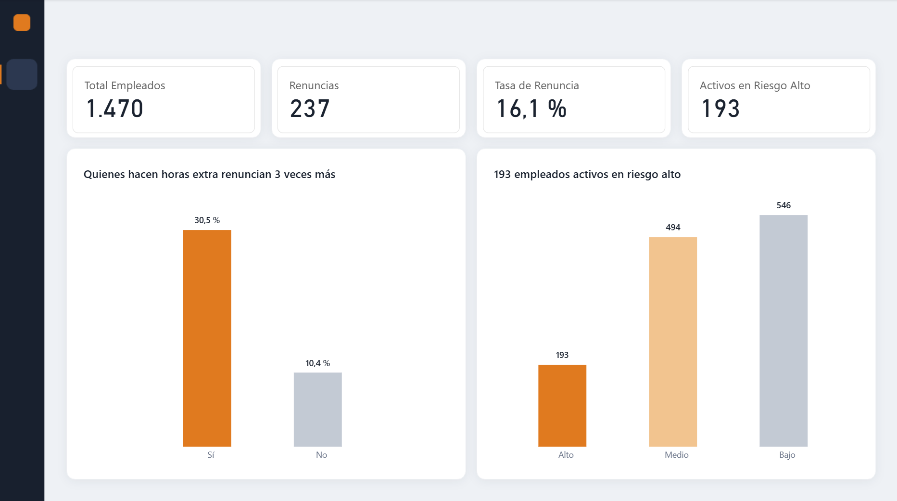
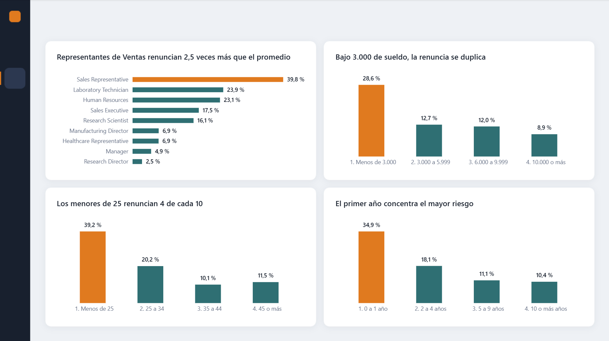
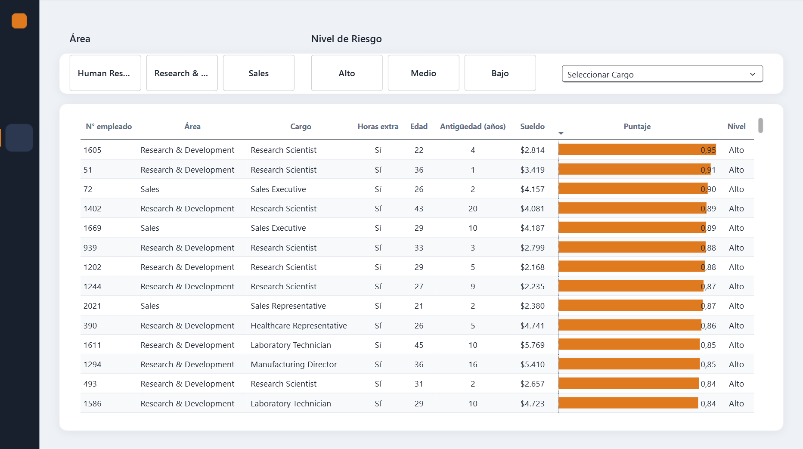

# Análisis de rotación de personal (People Analytics)

¿Qué empleados tienen más riesgo de renunciar y por qué? Este proyecto analiza la rotación de personal de una empresa en tres etapas: **SQL** para identificar los factores asociados a la renuncia, **Python** para separar el efecto de cada factor y estimar el riesgo de cada empleado, y **Power BI** para presentar los resultados.

## Hallazgos principales

- **Las horas extra son el factor más fuerte.** Quienes hacen horas extra renuncian 3 veces más (30,5% vs 10,4%). Son el 28% de la plantilla, pero concentran más de la mitad de las renuncias. El efecto se mantiene en todos los cargos, tramos de sueldo, edades y niveles de antigüedad, y es el factor con mayor peso en el modelo.
- **El sueldo bajo pesa, pero solo bajo cierto umbral.** Quienes ganan menos de 3.000 renuncian a una tasa de 28,6%; sobre ese monto la tasa cae a cerca de 12% o menos.
- **La renuncia se concentra en jóvenes y cargos de entrada.** Los menores de 25 años renuncian a 39,2%, y los Representantes de Ventas a 39,8%.
- **La alta renuncia del primer año se explica por quiénes son los nuevos.** Los empleados con 0 a 1 año renuncian a 34,9%, pero el modelo muestra que esto se debe principalmente a que son más jóvenes y ganan menos, no a la antigüedad en sí.
- **Los factores se suman.** Más de la mitad de los empleados con sueldo bajo y horas extra renuncia (56,1%).
- **Es posible anticipar renuncias.** Un modelo de regresión logística detecta 2 de cada 3 renuncias en datos no vistos, con el doble de certeza que el azar, y asigna un puntaje de riesgo a cada empleado activo.
- **193 empleados activos están en riesgo alto.** Un dashboard en Power BI permite filtrarlos por área, cargo y nivel de riesgo para priorizar acciones de retención.

## Dashboard



| Factores | Empleados en riesgo |
|---|---|
|  |  |

## Estructura del repositorio

```
analisis-rotacion-personal/
├── README.md
├── sql/
│   └── consultas_rotacion.sql      Análisis por grupos y cruces
├── python/
│   └── analisis_rotacion.ipynb     Correlaciones, modelo y puntaje de riesgo
└── powerbi/
    ├── analisis_rotacion.pbix      Dashboard interactivo
    └── capturas/                   Imágenes de cada página
```

## Datos

- **Fuente:** dataset *IBM HR Analytics Employee Attrition & Performance*, disponible en Kaggle. Son datos ficticios creados por IBM con fines de práctica.
- **Tamaño:** 1.470 empleados y 35 variables (datos personales, laborales, de sueldo y de satisfacción).
- **Variable objetivo:** `Attrition` (Yes = renunció, No = sigue en la empresa).
- **Tasa de renuncia general:** 16,1% (237 de 1.470).

## Herramientas

- **MySQL 8** y MySQL Workbench
- **Python 3.11:** pandas, SQLAlchemy, scikit-learn (Jupyter Notebook en VS Code)
- **Power BI Desktop:** DAX, Power Query

## Metodología

**Etapa 1: SQL**

1. Importación del CSV a una base de datos MySQL y verificación del total de registros.
2. Cálculo de la **tasa de renuncia** (renuncias / total) para distintos grupos, usando `CASE`, `SUM`, `COUNT` y `GROUP BY`.
3. Agrupación de variables continuas (sueldo, edad, antigüedad) en **tramos**.
4. **Cruce con horas extra** en cada análisis, para comprobar si cada factor tiene efecto propio o si se explica por otra variable.
5. Revisión del **tamaño de cada grupo** antes de sacar conclusiones, ya que los porcentajes de grupos pequeños son menos confiables.

**Etapa 2: Python**

1. Conexión a MySQL con SQLAlchemy y carga de los datos en pandas.
2. **Correlación** de todas las variables con la renuncia y eliminación de columnas constantes.
3. Revisión de **multicolinealidad** entre variables de carrera, para elegir una variable representativa por grupo.
4. **Regresión logística** con variables estandarizadas, para medir el efecto propio de cada factor.
5. **Evaluación** con datos de prueba (25%) y ajuste por desbalance de clases.
6. Cálculo de un **puntaje de riesgo** por empleado, guardado en MySQL para Power BI.

**Etapa 3: Power BI**

1. Conexión a MySQL y carga de las tablas `employees` y `riesgo_renuncia`, relacionadas por `EmployeeNumber`.
2. Medidas en **DAX** (total de empleados, renuncias, tasa de renuncia y activos en riesgo alto) y columnas calculadas para los tramos de sueldo, edad y antigüedad.
3. Dashboard de tres páginas con títulos que resumen la conclusión de cada gráfico y un color de alerta reservado para los grupos de mayor riesgo.

## Análisis en SQL

Las consultas completas están en [`sql/consultas_rotacion.sql`](sql/consultas_rotacion.sql).

### 1. ¿Cómo cambia la tasa de renuncia según el área y el cargo?

**La renuncia se concentra en los cargos de entrada, más que en un área específica.**

| Área | Total | Renuncias | Tasa |
|---|---:|---:|---:|
| Sales | 446 | 92 | 20,6% |
| Human Resources | 63 | 12 | 19,0% |
| Research & Development | 961 | 133 | 13,8% |

| Cargo | Total | Renuncias | Tasa |
|---|---:|---:|---:|
| Sales Representative | 83 | 33 | 39,8% |
| Laboratory Technician | 259 | 62 | 23,9% |
| Human Resources | 52 | 12 | 23,1% |
| Sales Executive | 326 | 57 | 17,5% |
| Research Scientist | 292 | 47 | 16,1% |
| Manufacturing Director | 145 | 10 | 6,9% |
| Healthcare Representative | 131 | 9 | 6,9% |
| Manager | 102 | 5 | 4,9% |
| Research Director | 80 | 2 | 2,5% |

- Ventas tiene la tasa más alta por área (20,6%). RR.HH. también está sobre el promedio (19,0%), pero con solo 63 personas la cifra es menos confiable.
- Por cargo, los **Representantes de Ventas** renuncian casi 2,5 veces más que el promedio (39,8%).
- Los **Técnicos de Laboratorio** (23,9%) aportan 62 renuncias, más de un cuarto del total, por ser un grupo grande.
- Los cargos directivos y gerenciales tienen tasas bajo el 7%.

### 2. ¿Los que hacen horas extra renuncian más?

**Sí. Es el factor más fuerte del análisis, y su efecto se mantiene dentro de cada cargo.**

| Horas extra | Total | Renuncias | Tasa |
|---|---:|---:|---:|
| Sí | 416 | 127 | 30,5% |
| No | 1.054 | 110 | 10,4% |

Al comparar dentro de un mismo cargo, quienes hacen horas extra renuncian bastante más en casi todos los casos:

| Cargo | Tasa sin horas extra | Tasa con horas extra |
|---|---:|---:|
| Sales Representative | 28,8% | 66,7% |
| Laboratory Technician | 15,7% | 50,0% |
| Human Resources | 17,9% | 38,5% |
| Research Scientist | 7,2% | 34,0% |
| Sales Executive | 11,2% | 33,0% |
| Manager | 1,3% | 14,8% |
| Manufacturing Director | 5,7% | 10,3% |
| Healthcare Representative | 7,4% | 5,4% |
| Research Director | 1,8% | 4,3% |

- Menos de un tercio de la empresa (28%) genera más de la mitad de las renuncias (127 de 237).
- El cargo y las horas extra se suman: 2 de cada 3 Representantes de Ventas con horas extra renuncian (grupo pequeño, de 24 personas).
- La única excepción es Healthcare Representative, con muy pocas renuncias para ser concluyente.

### 3. ¿Influye el sueldo?

**Sí, pero el efecto se concentra en los sueldos más bajos y es menor que el de las horas extra.**

Quienes renunciaron ganaban en promedio 4.787, cerca de un 30% menos que quienes se quedaron (6.833). Como el promedio se ve afectado por los sueldos altos de los cargos directivos, se analizó también por tramos:

| Tramo de sueldo mensual | Total | Renuncias | Tasa | Tasa sin horas extra | Tasa con horas extra |
|---|---:|---:|---:|---:|---:|
| Menos de 3.000 | 395 | 113 | 28,6% | 17,4% | 56,1% |
| 3.000 a 5.999 | 519 | 66 | 12,7% | 8,5% | 24,1% |
| 6.000 a 9.999 | 275 | 33 | 12,0% | 8,0% | 22,4% |
| 10.000 o más | 281 | 25 | 8,9% | 6,6% | 14,1% |

- La renuncia no baja de forma gradual: hay un **umbral** en 3.000. El tramo más bajo es el 27% de la plantilla, pero concentra casi la mitad de las renuncias (113 de 237).
- El sueldo bajo tiene efecto propio: sin horas extra, el tramo bajo 3.000 renuncia al doble que los demás tramos (17,4% vs ~8%).
- **Perfil de mayor riesgo:** sueldo bajo 3.000 + horas extra = 56,1% de renuncia, sobre un grupo de 114 personas.
- Las horas extra pesan más que el sueldo: un empleado con sueldo medio y horas extra (24,1%) renuncia más que uno con sueldo bajo sin horas extra (17,4%).

### 4. ¿Influyen la edad y los años en la empresa?

**Sí. El riesgo se concentra en los empleados jóvenes y en los recién llegados, y aumenta fuertemente con las horas extra.**

| Tramo de edad | Total | Renuncias | Tasa | Tasa sin horas extra | Tasa con horas extra |
|---|---:|---:|---:|---:|---:|
| Menos de 25 | 97 | 38 | 39,2% | 25,8% | 67,7% |
| 25 a 34 | 554 | 112 | 20,2% | 13,3% | 40,4% |
| 35 a 44 | 505 | 51 | 10,1% | 5,6% | 20,5% |
| 45 o más | 314 | 36 | 11,5% | 8,1% | 19,4% |

| Años en la empresa | Total | Renuncias | Tasa | Tasa sin horas extra | Tasa con horas extra |
|---|---:|---:|---:|---:|---:|
| 0 a 1 | 215 | 75 | 34,9% | 25,3% | 55,1% |
| 2 a 4 | 365 | 66 | 18,1% | 11,2% | 35,2% |
| 5 a 9 | 524 | 58 | 11,1% | 6,1% | 24,1% |
| 10 o más | 366 | 38 | 10,4% | 7,8% | 17,5% |

- **Edad:** desde los 35 años la tasa baja a cerca de 10%. El tramo de 25 a 34 es el que más renuncias aporta (112 de 237), por ser el más numeroso.
- **Antigüedad:** quienes llevan 0 a 1 año concentran casi un tercio de las renuncias (75 de 237). La tasa baja gradualmente y se estabiliza cerca del 10% desde los 5 años.
- Con horas extra, el riesgo se dispara: 55,1% en empleados de primer año y 40,4% en el tramo de 25 a 34 años (141 personas, 57 renuncias).
- Edad, antigüedad y sueldo están relacionados entre sí, por lo que las tablas cruzadas no permiten separar sus efectos. Esto se resuelve en la etapa con Python.

## Análisis en Python

El notebook completo, con el código y los resultados, está en [`python/analisis_rotacion.ipynb`](python/analisis_rotacion.ipynb).

### 5. Correlación y selección de variables

La correlación de todas las variables con la renuncia confirma que las **horas extra** son la variable más relacionada (0,25). También aparecen factores no revisados en SQL: las **acciones de la empresa** y el **involucramiento y la satisfacción**. El **desempeño** no tiene relación con la renuncia: se van tanto empleados de alto como de bajo desempeño.

Las variables de carrera están muy relacionadas entre sí (por ejemplo, nivel del cargo y sueldo tienen una correlación de 0,95). Para evitar **multicolinealidad**, se eligió una variable por grupo: sueldo (`MonthlyIncome`), años en la empresa (`YearsAtCompany`) y edad (`Age`).

### 6. ¿Cuánto pesa cada factor por sí solo?

Una **regresión logística** con variables estandarizadas mide el efecto de cada factor manteniendo los demás constantes:

| Variable | Coeficiente | Efecto |
|---|---:|---|
| Horas extra | 0,73 | Aumenta el riesgo |
| Número de empresas anteriores | 0,33 | Aumenta el riesgo |
| Distancia de la casa | 0,27 | Aumenta el riesgo |
| Años en la empresa | -0,11 | Reduce el riesgo |
| Equilibrio vida-trabajo | -0,17 | Reduce el riesgo |
| Satisfacción con el trabajo | -0,34 | Reduce el riesgo |
| Satisfacción con el ambiente | -0,38 | Reduce el riesgo |
| Involucramiento | -0,39 | Reduce el riesgo |
| Edad | -0,41 | Reduce el riesgo |
| Acciones de la empresa | -0,45 | Reduce el riesgo |
| Sueldo mensual | -0,47 | Reduce el riesgo |

- **Las horas extra son el factor principal**, con un efecto mucho mayor que cualquier otra variable.
- **Sueldo, acciones, edad, involucramiento y satisfacción** tienen efectos propios de magnitud similar.
- **La antigüedad casi no pesa** al comparar empleados de igual edad y sueldo: la alta renuncia del primer año que se vio en SQL se explica principalmente porque los empleados nuevos son más jóvenes y ganan menos.
- Haber trabajado en **muchas empresas** y vivir **lejos** aumentan el riesgo.

### 7. ¿El modelo sirve para anticipar renuncias?

El modelo se entrenó con el 75% de los empleados y se evaluó con el 25% restante. Como solo el 16% renuncia, se ajustó para dar más peso a las renuncias (`class_weight="balanced"`):

| Métrica | Modelo base | Modelo ajustado |
|---|---:|---:|
| Detección (recall) | 22% | **64%** |
| Precisión | 65% | 33% |
| AUC | 0,78 | 0,79 |
| Exactitud | 85,6% | 73,6% |

- El modelo ajustado **detecta casi 2 de cada 3 renuncias**, el triple que el modelo base.
- Su precisión (33%) es **el doble que el azar** (16%).
- La exactitud del modelo base es engañosa: un modelo que dijera que nadie renuncia acertaría el 84%.

**Lectura para el negocio:** conversando con los empleados marcados como riesgo (cerca de 3 de cada 10), el área de personas podría llegar a tiempo a casi 2 de cada 3 personas que se iban a ir, a cambio de que 2 de cada 3 conversaciones sean con personas que no pensaban irse.

### 8. Puntaje de riesgo por empleado

Con el modelo final se calculó un **puntaje de riesgo** para cada empleado, guardado en MySQL (tabla `riesgo_renuncia`) para el dashboard:

| Nivel de riesgo | Empleados activos |
|---|---:|
| Alto (> 0,6) | 193 (16%) |
| Medio (0,3 a 0,6) | 494 (40%) |
| Bajo (< 0,3) | 546 (44%) |

Los 193 empleados activos en riesgo alto son la lista prioritaria para acciones de retención. El puntaje sirve para ordenar y priorizar, no como probabilidad literal de renuncia, ya que el ajuste por desbalance infla sus valores.

## Dashboard en Power BI

El archivo está en [`powerbi/analisis_rotacion.pbix`](powerbi/analisis_rotacion.pbix). Tiene tres páginas:

| Página | Contenido | Para qué sirve |
|---|---|---|
| **Resumen** | Indicadores generales (1.470 empleados, 237 renuncias, tasa de 16,1%, 193 activos en riesgo alto), tasa de renuncia según horas extra y empleados activos por nivel de riesgo | Entender la situación general en un vistazo |
| **Factores** | Tasa de renuncia por cargo, tramo de sueldo, edad y antigüedad | Ver qué grupos concentran el riesgo |
| **Empleados en riesgo** | Tabla de empleados activos ordenada por puntaje de riesgo, con filtros por área, cargo y nivel de riesgo | Priorizar a quién contactar primero |

**Decisiones de diseño:**

- Cada gráfico tiene un **título con la conclusión** (por ejemplo, "Quienes hacen horas extra renuncian 3 veces más"), para que el mensaje se entienda sin leer los números.
- El **naranjo** se usa solo para los grupos de mayor riesgo (horas extra, riesgo alto, el tramo más crítico de cada factor); el resto va en colores neutros.
- La tabla de riesgo muestra solo a los **empleados activos**, porque son a quienes la empresa todavía puede retener.

*Nota:* el archivo se conecta a una base MySQL local, por lo que actualizar los datos requiere recrear la base con el script SQL y el notebook. El archivo incluye una copia de los datos, así que se puede abrir y explorar sin conexión.

## Recomendaciones

1. **Reducir las horas extra**, especialmente en cargos de entrada y en empleados nuevos. Es la medida con mayor impacto potencial.
2. **Revisar los sueldos del tramo más bajo**, en lugar de aplicar alzas generales: sobre los 3.000 la tasa de renuncia cambia poco.
3. **Trabajar la satisfacción y el involucramiento**, que tienen efecto propio y dependen directamente de la gestión de la empresa.
4. **Poner foco en los perfiles jóvenes y en cargos de entrada**, como Representantes de Ventas y Técnicos de Laboratorio, reforzando la inducción y el acompañamiento al ingresar.
5. **Usar el puntaje de riesgo** para priorizar conversaciones de retención con los empleados activos de riesgo alto.

## Limitaciones

- Los datos son ficticios, por lo que las conclusiones ilustran el método y no describen una empresa real.
- El análisis muestra **relaciones, no causas**.
- `OverTime` solo indica si la persona hace horas extra (sí/no), no cuántas. Con ese dato se podría identificar a partir de qué cantidad aumenta el riesgo.
- Algunos grupos cruzados en SQL son pequeños (menos de 50 personas), por lo que sus tasas deben tomarse como señales y no como cifras exactas.
- La regresión logística supone efectos lineales: si el riesgo de la antigüedad se concentra solo en el primer año, el modelo podría subestimarlo.
- El modelo solo puede usar la información disponible en el dataset. Factores como la relación con el jefe o las ofertas de otras empresas no están incluidos.

## Posibles mejoras

- Probar modelos más flexibles (por ejemplo, árboles de decisión) que capten efectos no lineales, como el riesgo concentrado en el primer año.
- Con datos reales, incorporar variables como la cantidad de horas extra, la evaluación del jefe o la fecha de renuncia, para analizar tendencias en el tiempo.

## Autor

Francisco Monsalve Bravo, Ingeniero Civil Industrial
